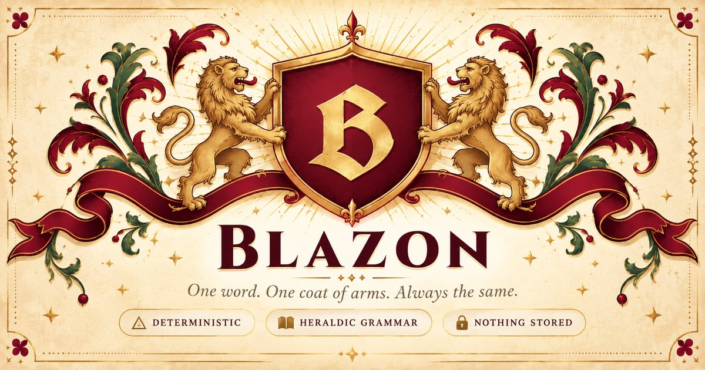

# Blazon

**One word. One coat of arms. Always the same. Gemma writes the motto.**

Type a word. Blazon hashes it, runs a fixed table of heraldic rules, and draws the arms with a formal blazon. Same word, same arms, every time, and you can check it. Then ask the herald, and Gemma writes a motto and a short piece of lore grounded in the arms it was given.

**Live:** https://blazon-g3jl.onrender.com
**Write-up:** _(dev.to link after publish)_
**Built for:** DEV Hacktoberfest Open-Source AI Challenge, Week 2: Side Hustle

---

## The split

| Part | Made by |
|---|---|
| Field, tinctures, charge, blazon, shield SVG | Rules. Hash of the word, fixed table. Never changes |
| Motto and lore | Gemma (`gemma-4-26b-a4b-it`), open weights |
| Fallback motto when Gemma is away | Fixed list, picked by the same hash |

The model writes the caption. The math draws the picture.

## Why open weights

A free download with a tip jar can't carry a per-call bill. Gemma on a capped free tier keeps the cost near zero, and because the weights are open, the same model can be self-hosted (Ollama stub in `server/gemma.js`) if the hosted tier ever changes. Nothing else in the app would move.

## Run it

```bash
npm install
GEMINI_API_KEY=your_key npm start   # http://localhost:3000
npm test                            # 21 tests, no network needed
```

No key? The app still works. Every motto request falls back to the house list.

## Layout

```
public/          the page: index.html, style.css, app.js
server/
  index.js       static files, /healthz, POST /motto
  gemma.js       the only file that calls the model
  validate.js    checks the request and the model's reply
  limits.js      rate limits and daily caps
test/            node --test, no network
PRD.md           what done looks like, and what it never does
render.yaml      Render blueprint (free plan)
```

## Honest limits

- SVG download only, no PNG.
- Render free tier sleeps. The first motto of the day takes about a minute while the server wakes.
- Motto calls are capped per day. When the cap hits, you get a house motto instead.
- The lore is invented folklore. It never claims a real family owns these arms.

## Credits

Part of [Clew Suite](https://clewlabs.org). Server carried over from [Two Sisters Tinctures](https://github.com/earlgreyhot1701D/two-sisters-tinctures). UI designed in Stitch. Built with GitHub Copilot and Claude.

AI assisted. Human approved. Powered by NLP.

If you print one and hang it, [buy me a coffee](https://buymeacoffee.com/earlgreyhot1701d).

MIT License.
